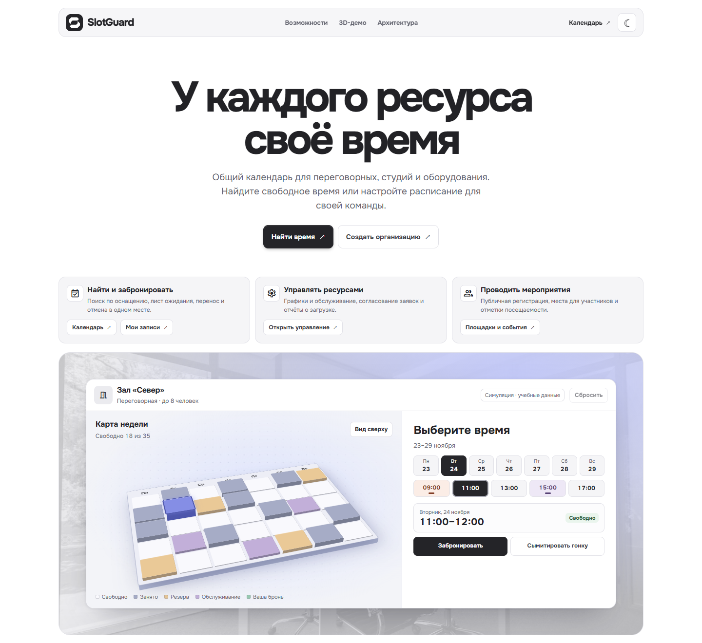
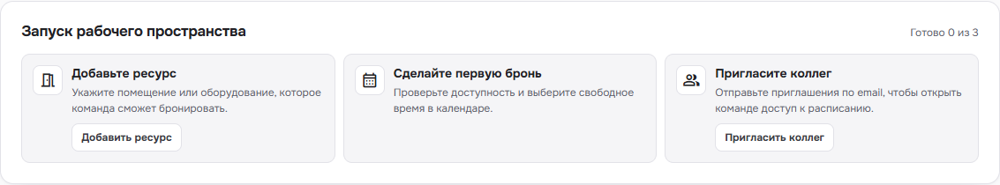
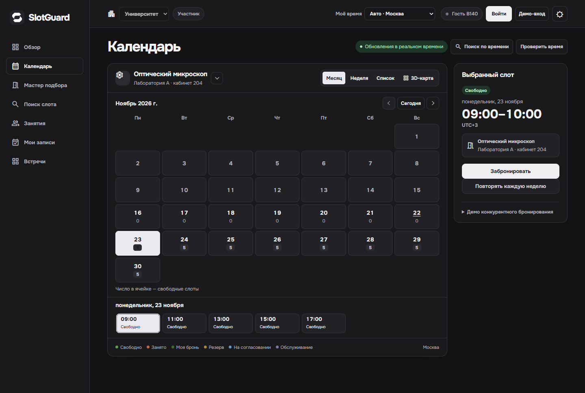
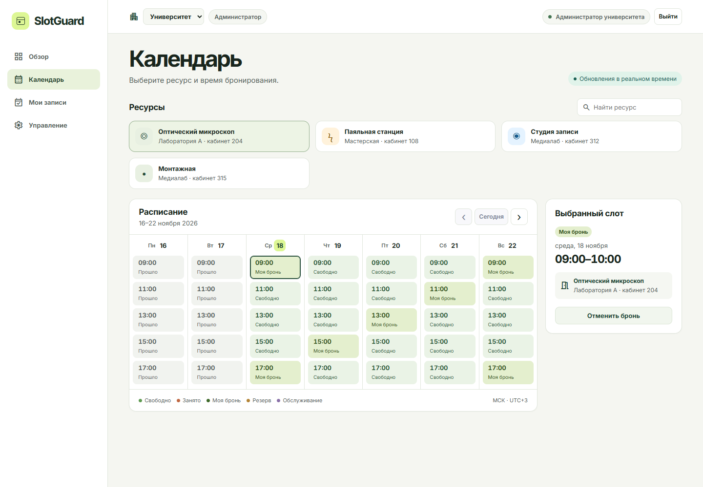
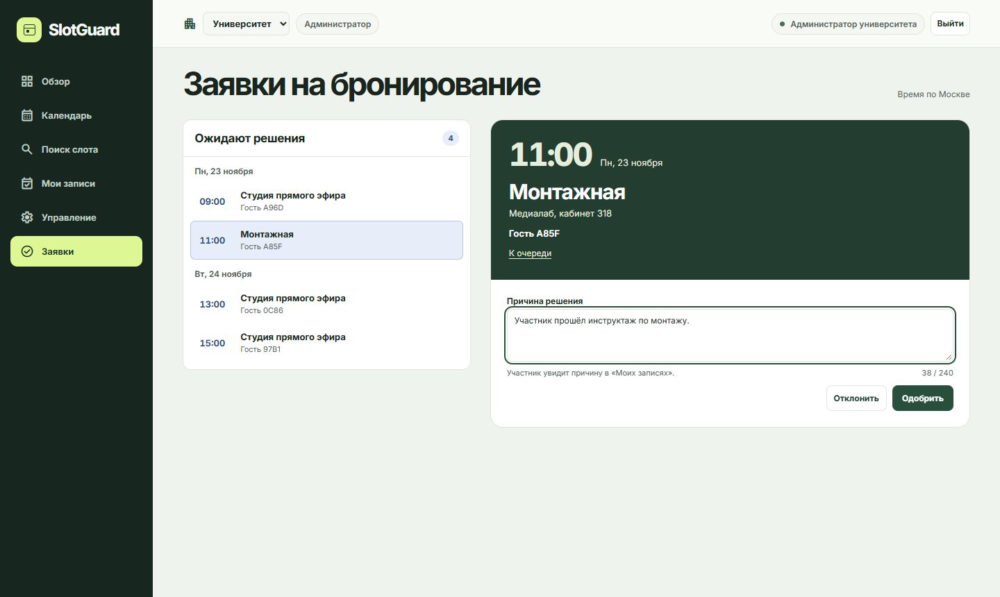
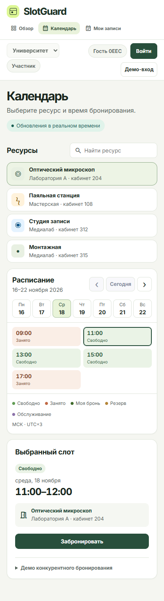

# SlotGuard

Календарь для команд, которые делят переговорные, студии и оборудование. Участник выбирает время и бронирует ресурс. Администратор задаёт график, правила доступа и интервалы обслуживания.



## Быстрый запуск

Запустите Docker с поддержкой Linux-контейнеров и выполните команды.

```sh
git clone https://github.com/npapaHAHA/SlotGuard.git
cd SlotGuard
docker compose up --build
```

Откройте [лендинг](http://127.0.0.1:8080/demo/) или [календарь](http://127.0.0.1:8080/#calendar). При первом запуске приложение применит миграции и создаст демо-каталоги университета и коворкинга.

Бронировать в университете можно сразу как гость. Чтобы открыть настройки, нажмите «Демо-вход» и используйте `university-admin` или `coworking-admin`. Пароль для локального демо — `slotguard_demo`.

Письма попадают в [Mailpit](http://127.0.0.1:8025). Для проверки подойдёт `vera@example.test`. Схема API доступна по адресу [`/openapi/v1.json`](http://127.0.0.1:8080/openapi/v1.json). Команда `docker compose down` останавливает сервисы и сохраняет данные в Docker-томах.

## Запуск своей команды

Нажмите [«Создать организацию»](http://127.0.0.1:8080/?start=register#overview), зарегистрируйтесь и подтвердите email. Дальше обзор проведёт по трём шагам: добавьте ресурс, сделайте первую бронь и пригласите коллегу. После принятия приглашения коллега откроет календарь с ролью участника.

Администратор может выбрать период и ресурс в разделе «Аналитика» и скачать текущий отчёт в CSV. В выгрузку входят загрузка, обслуживание, решения по заявкам, посещаемость и лист ожидания.



## Демо для собеседования

1. На [лендинге](http://127.0.0.1:8080/demo/) выберите свободное время и нажмите «Сымитировать гонку». На учебных данных видно, как один участник получает бронь, а второму предлагают свободные варианты.
2. В [рабочем календаре](http://127.0.0.1:8080/#calendar) выберите свободный слот. В карточке откройте «Демо конкурентного бронирования» и запустите 20 запросов. При одном свободном слоте ожидается один ответ `201 Created` и девятнадцать `409 Conflict`.
3. Откройте тот же слот в другом профиле браузера и встаньте в очередь. Отмените первую бронь. Следующий участник получит резерв на 10 минут, а его календарь обновится без перезагрузки. [Как показать передачу резерва](docs/USAGE.md#передача-слота-по-очереди)

## Возможности

- Календарь в режимах месяца, недели, списка и 3D-карты. Поиск учитывает тип ресурса, вместимость и оснащение и предлагает другое время при конфликте.
- Графики с перерывами и исключениями, буферы, лимиты, обслуживание и согласование заявок. Можно забронировать до шести ресурсов одним комплектом.
- Публичные и приватные ссылки, вопросы к брони, перенос с сохранением исходного времени при конфликте, файлы `.ics` и напоминания.
- Организации, подразделения, роли, двухфакторный вход и журнал изменений. Администратор видит загрузку ресурсов и воронку листа ожидания.
- Google Calendar, импорт `.ics`, iframe-виджет, внешний API и подписанные вебхуки. Платный сценарий использует демо-кассу.
- Публичный каталог, мероприятия с QR-билетами, браузерные звонки, PWA и расширение Chromium. [Подробности](docs/USAGE.md#площадки-встречи-и-клиенты)

<details>
<summary>Скриншоты рабочего пространства</summary>












</details>

## Как устроено бронирование

Приложение написано на C# и ASP.NET Core (.NET 10). Ограничение `EXCLUDE USING gist` в PostgreSQL запрещает пересекающиеся активные интервалы одного ресурса, включая резервы и обслуживание.

Отмена брони и выдача следующего резерва проходят в одной транзакции. В ней же сохраняется событие уведомления для Transactional Outbox. Если RabbitMQ недоступен, фоновый обработчик повторяет попытку, а база защищает от повторного уведомления. SignalR сообщает вкладкам нужной организации, что пора перечитать календарь. [Архитектура и транзакции](docs/USAGE.md#как-это-работает)

## Тесты

```sh
dotnet test SlotGuard.slnx --configuration Release
```

Для прогона нужны .NET 10 SDK и Docker. Testcontainers поднимает PostgreSQL и RabbitMQ. В наборе есть гонка из 20 независимых сеансов, проверка изоляции организаций, выдача резервов и восстановление доставки после сбоя брокера. [Прогон со своими PostgreSQL и RabbitMQ](docs/USAGE.md#интеграционные-тесты)

## Документация

- [Сценарии, API и настройки сервера](docs/USAGE.md)
- [Запуск через .NET SDK](docs/USAGE.md#запуск-через-net-sdk)
- [План релиза](docs/RELEASE-PLAN.md) и [разбор интерфейсов бронирования](docs/DESIGN-REFERENCES.md)

Первые этапы истории восстановлены из опубликованного MVP. Даты этих коммитов условные.
